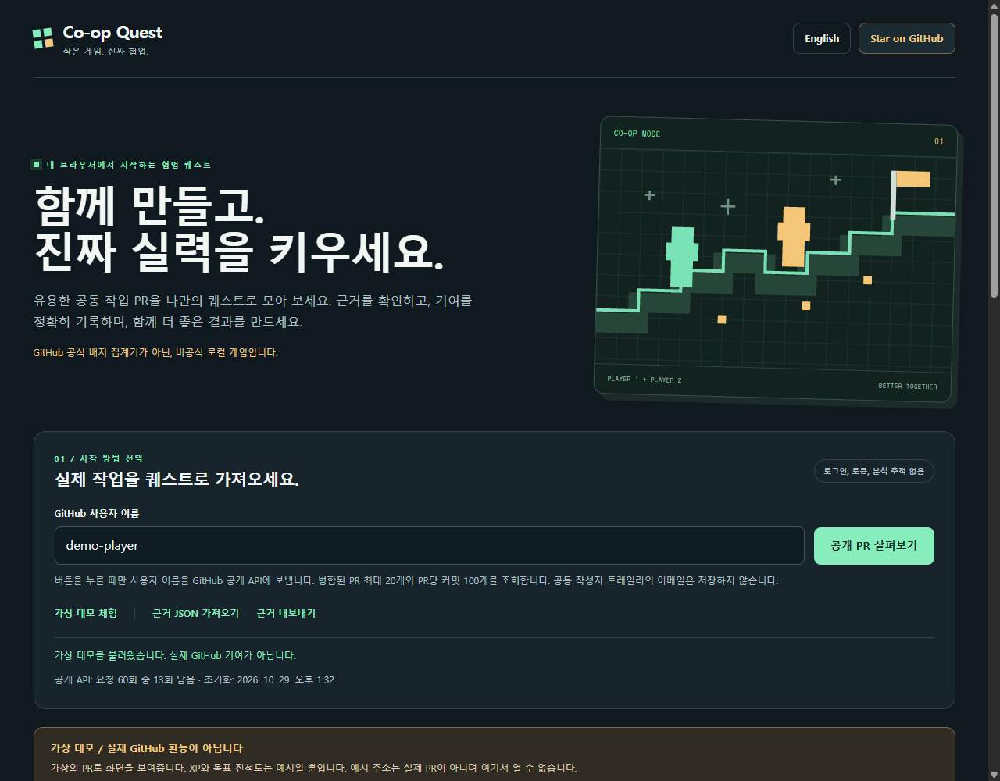

# Co-op Quest

**Ship together. Level up for real.**

A zero-dependency, privacy-first static web app for tracking the collaboration evidence in a local dataset. Midnight colors, mint and amber accents, readable normal text, English/Korean toggle, and a small RPG-style progression system.

[Open the web app](https://reasonofmoon.github.io/coop-quest/) · [Optional GAME MODE mod](MOD.md) · [Verification and limits](VERIFICATION.md)



Repository: https://github.com/Reasonofmoon/coop-quest

## Quick start

### GitHub Pages

1. Place `index.html`, `app.js`, `style.css`, and `.nojekyll` at the repository root. No build step is required.
2. In repository **Settings > Pages**, choose **Deploy from a branch**, then the intended branch and **/(root)**. Save.
3. Visit the Pages URL shown by GitHub after deployment. The expected project URL is `https://reasonofmoon.github.io/coop-quest/`, but deployment must be confirmed before treating it as live.

### Local preview

Serve the directory with any existing local static HTTP server and open its URL. There are no packages to install for the app, no backend, and no build command. A server is recommended instead of a `file://` URL because browser storage and security behavior differ for local files.

The optional standalone Claude Code mod lives in the same repository, with root entry `register.tsx`. See [MOD.md](MOD.md) for commands, privacy limits, and its beta validation status. The web app works without installing the mod.

## Use it

- **Try a synthetic demo** to explore five fictional examples. DEMO is prominent; the fake GitHub-form links cannot be opened from the cards. Demo data never becomes genuine user evidence.
- Enter a valid GitHub username and explicitly choose **Scan public PRs**. Nothing is fetched on load.
- **Import evidence JSON** from another tool, including the separately maintained mod. All imports are labeled imported evidence, not independently verified.
- Inspect each card's evidence. Search titles or filter by linked authors / trailer candidates.
- **Export evidence** downloads the normalized schema below. The private checklist is not included.
- The five-step personal checklist is local and independent. Checking boxes never changes PR counts or XP. **Reset checklist** affects only the checklist; **Clear dataset** affects only evidence.
- **Star on GitHub** is an ordinary optional link. Stars never unlock features, award XP, or influence progress. No star exchange exists.

## Honest counting

All counts mean **observed in this dataset only**, not an account-wide total. A PR URL is counted at most once, case-insensitively. The first valid occurrence wins when duplicate rows are imported.

Eligible linked-author rows must list both the player and at least one distinct other account in `coauthors`, ignoring case. This is stronger than a trailer name, but the app does not independently query or verify imported claims. `authorLogin` is the PR author for linked-author rows.

Eligible trailer-candidate rows must have `authorLogin` equal to the player and at least one distinct coauthor name. For REST results, the original GitHub-linked author of **the same commit** must match the player, and that commit must have a conventional `Co-authored-by: Name <email>` trailer. Names are retained; emails are never resolved to users, rendered, or saved. `authorLogin` is the original commit author for trailer-candidate rows. A trailer is not proof of a GitHub account, verified person, official contribution credit, or badge award.

Each unique eligible PR yields **100 local XP**. Level is `1 + floor(XP / 300)`. Candidates can earn local game XP, but that does not make them confirmed GitHub credit. Checklist work gives no XP.

The ladder **1 / 10 / 24 / 48** uses community-reported Pair Extraordinaire thresholds from https://github.com/gomzyakov/github-achievements. It is a local goal ladder, not an official badge prediction. The app never infers that GitHub awarded a badge.

## Public REST scan limits

- Explicit unauthenticated request to `api.github.com/search/issues` with `is:pr is:merged author:NAME is:public`, `per_page=20`, page 1, sorted by updated time.
- At most **20 PRs**, only PRs the player opened, not all PRs to which they contributed.
- For each result: PR details, then `commits?per_page=100&page=1`.
- **Two concurrent PR workers**, each performing sequential requests. No commit pagination beyond the first 100 commits. At most 41 requests per full 20-PR scan.
- The first eligible commit per PR supplies the evidence. Additional qualifying commits do not add XP.
- Account-wide coverage is always incomplete. Search limits, recent ordering, failed requests, rate limits, and PRs containing more than 100 commits can hide valid work.
- Remaining API quota and reset time are shown when GitHub exposes the response headers. Unauthenticated quotas can be shared by IP.
- HTTP 403/429 stops the scan. Network failures and timeouts are handled. **Cancel scan** aborts requests and saves only completed candidate evidence as a partial dataset. A failed or cancelled scan with no completed candidates preserves the previous dataset. Completed partial evidence may replace it; export important evidence first.
- A PR can be skipped when it is no longer available or no longer merged. An empty result does not establish that an account has no collaboration history.

## Import / export schema

Maximum UTF-8 file size: **2 MB**. Maximum input rows: **1,000**. Sources: `public-rest`, `graphql`, `demo`. UTC ISO timestamps ending in `Z` are required. Unknown fields are discarded; the boolean `coverage.truncated` is preserved (missing means conservatively truncated). Linked-author rows may have `authorLogin: null` for deleted PR authors, and titles can contain up to 500 characters. All normalized coverage has `complete: false`, even if an input claims completeness.

```json
{
  "schemaVersion": 1,
  "player": "Reasonofmoon",
  "source": "graphql",
  "scannedAt": "2026-10-29T12:00:00.000Z",
  "coverage": {
    "complete": false,
    "scope": "Imported public linked-author evidence; scope supplied by the exporting tool"
  },
  "pullRequests": [
    {
      "url": "https://github.com/example-owner/example-repo/pull/1",
      "title": "Example schema row, not a genuine contribution claim",
      "mergedAt": "2026-10-28T12:00:00.000Z",
      "authorLogin": "example-owner",
      "coauthors": ["Reasonofmoon", "example-teammate"],
      "evidence": "linked-authors",
      "commitSha": "0123456789abcdef0123456789abcdef01234567"
    }
  ]
}
```

The schema example is fictional. Replace it with actual exported evidence, not fabricated achievements.

Validation rejects malformed rows rather than silently trusting them. PR URLs must be exactly HTTPS `github.com/OWNER/REPO/pull/NUMBER`, without credentials, a custom port, query string, or fragment. Usernames are strictly validated. Titles, scope, coauthor lists, SHA values, timestamps, row counts, and file size are capped/validated. Linked-author coauthors must be GitHub usernames. Trailer candidates may use plain names but cannot contain email syntax. Optional SHAs are 7–64 hexadecimal characters. Rows failing eligibility may still be displayed for inspection, but never contribute XP.

## Privacy and security

- Evidence, language, username, and checklist use only this origin's `localStorage`.
- No accounts, OAuth, tokens, credentials, analytics, remote fonts, external packages, or backend.
- The public scan sends the chosen username and your IP to GitHub. Requests use `credentials: omit`. No automatic API request runs on startup or language changes.
- Exports are downloaded locally; importing does not upload the file.
- Commit messages are inspected in memory. Only sanitized coauthor names and an optional commit SHA are saved, never trailer emails or raw messages.
- Dynamic content uses DOM nodes and `textContent`, never HTML injection. External PR links are allowlisted; opened links use `noopener noreferrer`. A restrictive Content Security Policy limits scripts/styles to this app and network connections to the GitHub API.
- Local storage is not encrypted. This is not a secrets vault. Shared browser profiles can read local data. Clear evidence or browser site data when appropriate. The checklist is separate from **Clear dataset**.
- If browser storage is unavailable/full, the app warns that changes may last for the current session only.
- Reduced-motion preferences disable celebration animation. Keyboard focus, labels, live status, and mobile layouts are included.

## 한국어 빠른 시작

**함께 만들고, 진짜 실력을 키우세요.** Co-op Quest는 공식 GitHub 배지 집계기가 아닌 비공식 로컬 게임입니다.

1. 루트에 `index.html`, `app.js`, `style.css`, `.nojekyll`을 둡니다. 빌드나 패키지 설치가 필요하지 않습니다.
2. GitHub **Settings > Pages**에서 **Deploy from a branch**와 원하는 브랜치의 **/(root)**를 선택합니다. GitHub가 표시한 배포 주소에서 확인하세요.
3. 로컬에서는 기존 정적 HTTP 서버로 폴더를 열어 확인하세요. `file://`는 브라우저별 저장 및 보안 동작이 달라 권장하지 않습니다.
4. 오른쪽 위 **한국어** 버튼으로 언어를 바꿀 수 있습니다. 선택한 언어는 이 브라우저에 저장됩니다.
5. **가상 데모 체험**은 실제 기여가 아닙니다. 예시 주소를 실제 PR로 열 수 없습니다.
6. 사용자 이름을 입력하고 **공개 PR 살펴보기**를 누를 때만 GitHub 공개 API를 조회합니다. 자동 조회, 로그인, 토큰 입력은 없습니다.
7. **근거 JSON 가져오기**와 **근거 내보내기**로 별도 도구와 자료를 주고받습니다. 가져온 자료는 앱에서 직접 검증하지 않았다고 표시합니다.

### 중요한 한계

- 공개 조회는 본인이 연 병합 PR 최대 20개와 PR당 처음 100개 커밋만 확인합니다. 계정 전체 집계가 아닙니다.
- 같은 커밋의 원래 작성자 계정이 본인이고 `Co-authored-by` 트레일러가 있어야 REST 후보가 됩니다. 이메일을 계정으로 연결하거나 사람을 검증하지 않습니다.
- 작성자 연결 근거는 `coauthors`에 본인과 다른 계정이 함께 있어야 조건을 충족합니다. 그래도 가져온 자료를 앱이 직접 검증하지는 않습니다.
- 고유 조건 충족 PR당 로컬 100 XP, 300 XP마다 레벨이 1씩 늘어납니다. 후보의 로컬 XP는 공식 GitHub 기여 확정이 아닙니다.
- 1/10/24/48개 목표는 커뮤니티 보고 기준입니다. 공식 배지 획득 여부를 추정하지 않습니다.
- 체크리스트는 실제 작업을 돕는 개인 메모입니다. 체크해도 PR 수나 XP는 늘지 않습니다.
- 데이터는 이 브라우저에만 저장됩니다. API 조회를 누르면 사용자 이름과 IP가 GitHub에 전달됩니다. 이메일은 저장하지 않습니다.
- JSON은 2 MB 및 1,000행 이하여야 합니다. 올바른 PR 주소와 UTC ISO 날짜 등이 필요합니다. 위 영문 설명의 스키마를 사용하세요.
- 같은 저장소의 독립 Claude Code mod는 루트 `register.tsx`를 사용합니다. 명령어와 베타 검증 범위는 [MOD.md](MOD.md)를 확인하세요. 웹앱만 사용해도 됩니다.

## License

MIT. Copyright 2026 Reasonofmoon.
